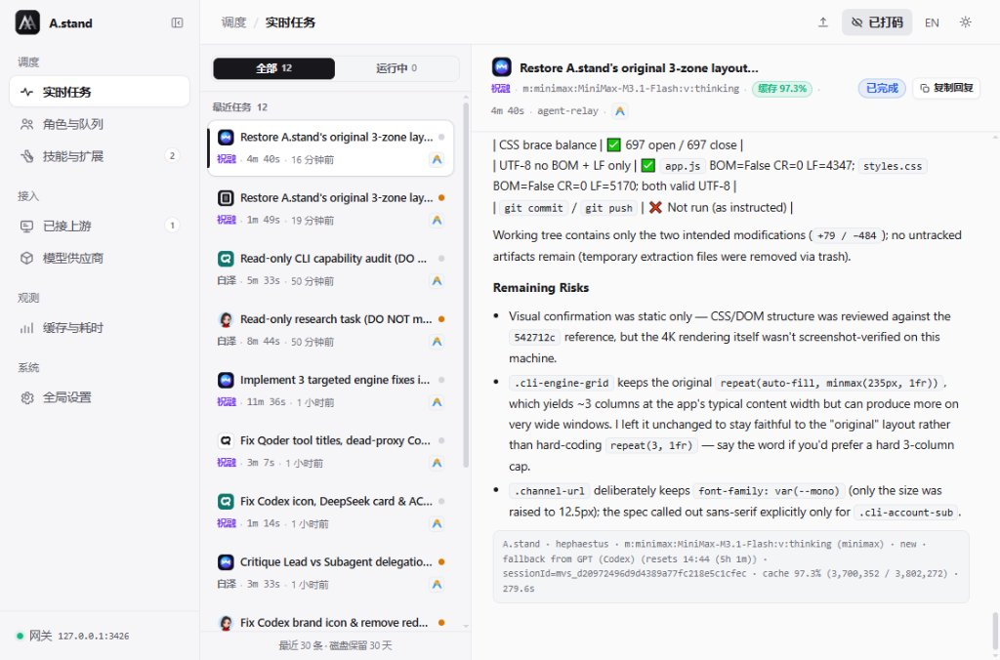
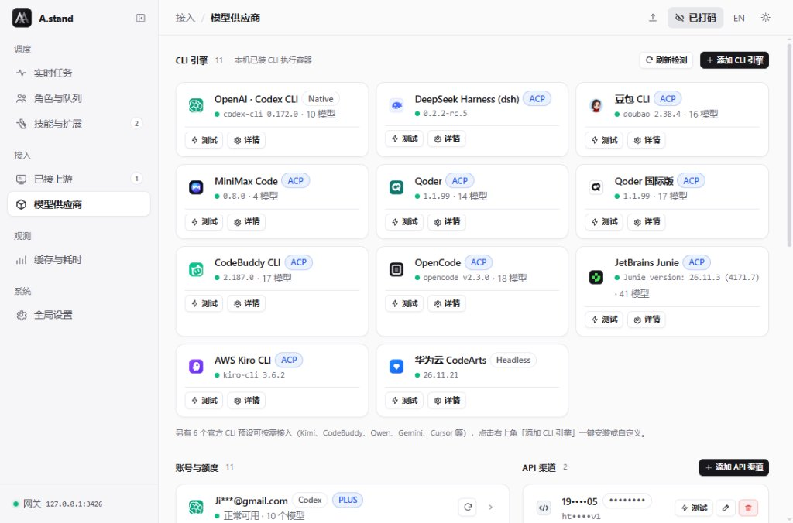
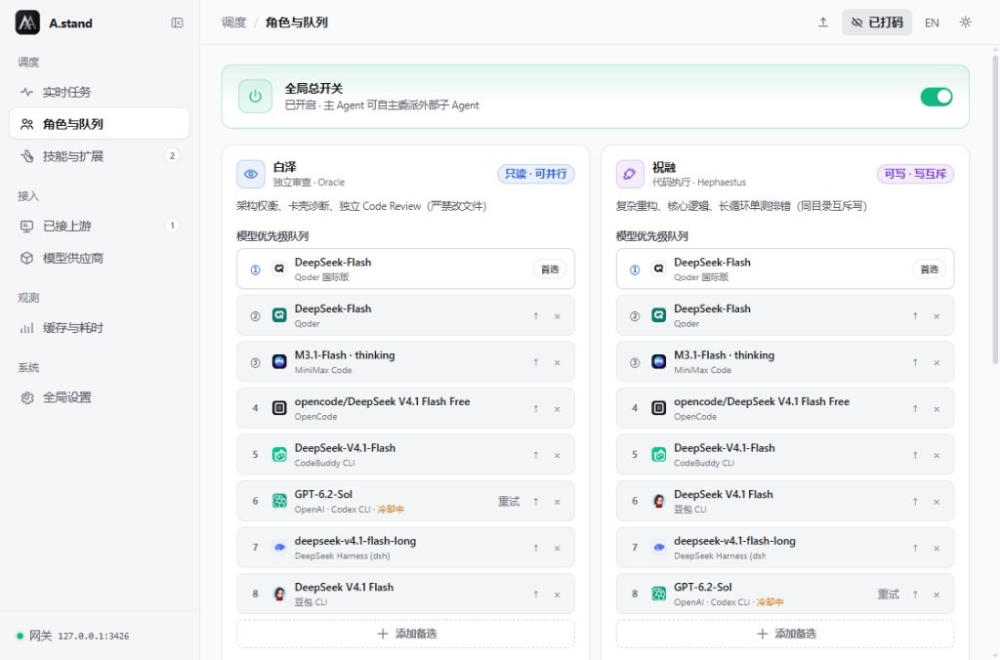
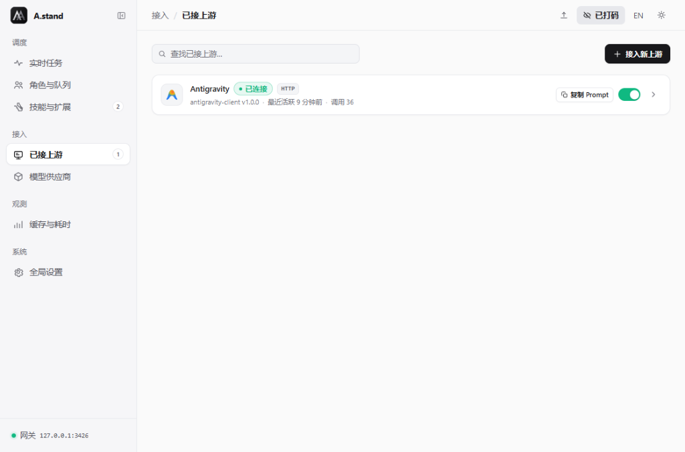

<p align="center">
  
</p>

<h1 align="center">A.stand <sup>v2</sup></h1>

<p align="center">
  <strong>Turn 13+ official local AI coding CLIs into persistent, isolated subagents for any MCP host</strong><br/>
  Windows tray desktop console · local Streamable HTTP daemon on <code>127.0.0.1:3426</code><br/>
  Real Prompt Cache · quota pooling &amp; rotation · zero mutation of external CLI configs
</p>

<p align="center">
  <a href="./README.zh-CN.md">中文说明</a> · <a href="./AGENT_INSTALL.md">AI Agent Install Guide</a> · <a href="./docs/ARCHITECTURE.md">Architecture</a> · <a href="./SECURITY.md">Security</a> · <a href="./llms.txt">llms.txt</a>
</p>

<p align="center">
  <a href="https://github.com/jia-cyber957/A.stand/actions/workflows/ci.yml"></a>
  <a href="./LICENSE"></a>
  = 20" />
</p>

> **Fastest install: let your AI do it.**
> Paste this into **Antigravity, Claude Code, Cursor, Codex**, or any MCP host:
> ```text
> Read AGENT_INSTALL.md at https://github.com/jia-cyber957/A.stand, install and launch A.stand v2, connect my current MCP client, and walk me through configuring model providers and priority queues.
> ```
> It follows [AGENT_INSTALL.md](./AGENT_INSTALL.md) step by step: read-only probe, build/launch, MCP wiring, rules and Skill placement, then asks for your confirmation before any sensitive action.

---

## What problem does it solve?

A.stand v2 is **one resident desktop console plus a local HTTP daemon** (loopback only, default `127.0.0.1:3426`). It turns the official AI coding CLIs already installed and signed in on your machine into persistent subagents that **any MCP host** can call:

- **Keeps the Lead context clean**: a subagent may read dozens of files and accumulate 200K+ tokens of tool output inside its own process; the Lead Agent receives only a concise **1–3K summary**, so the main conversation stays crisp and fast.
- **Real cache, never estimated**: follow-ups on the same task reuse the explicit `sessionId` across restarts; measured **95%–99.8% Prompt Cache** hit rates come from genuine upstream billing counters (Codex, DeepSeek, Anthropic, `dsh` projection cache and compressed session logs).
- **Pool and rotate quotas**: free tiers, bundled subscription credits, and multiple accounts can share one priority queue. On 429 / 5xx / 401, A.stand cools the channel down, fails over, and restores the primary when its reset window passes.
- **Zero mutation of external CLI configs**: A.stand itself never edits `~/.codex/config.toml`, `~/.dsh/`, `~/.claude/`, `~/.gemini/antigravity-cli/`, or similar config files. It drives each CLI with ephemeral launch arguments, isolated profiles, and per-process environment variables.

---

## Screenshots (4K ClearType)

### Live Activity: multiple CLIs in one chatroom, real cache, collapsible steps



A calm, chatroom-style live stream: each job shows its source CLI, role (Oracle / Hephaestus), elapsed time, and real Prompt Cache hit rate. Steps such as `Analyzed`, `Edited`, and `Ran tests` collapse into one line, while the final Markdown answer renders inline. The `Mask` toggle hides accounts and keys for safe screenshots.

### Model Providers: 3-zone layout for CLIs, accounts/quotas, and API channels



The top zone is the CLI engine grid (Native / ACP / Headless); bottom-left is accounts and real quota; bottom-right is OpenAI-compatible API channels. CLI install, update, sign-in, model whitelisting, and quota refresh all happen on this page.

### Roles & Queues: Oracle read-only in parallel, Hephaestus workspace-write with a mutex



Oracle (`白泽`) is strictly read-only and can run in parallel. Hephaestus (`祝融`) defaults to workspace-write with a per-directory write mutex; opt-in Git worktree parallelism is available in Settings. Each queue supports a primary, fallbacks, cooldowns, retry, and smart model selection.

### Connected Upstream Hosts: one-click AI setup prompt plus HTTP / stdio MCP



Any MCP client can connect. Generate a dedicated token, copy the **AI setup prompt**, and send it to the host AI: it wires the MCP server, delegation rules, and bundled Skill in one shot. Equivalent HTTP JSON and stdio bridge configs are provided as well.

---

## Four-step guide

### Step 1: Install & launch

**Lazy path (let your AI install it)**

Send the prompt above to any host AI, or open [AGENT_INSTALL.md](./AGENT_INSTALL.md). It is an executable playbook for AI agents covering environment probing, build, connection, provider sign-in, and a verification checklist.

**Manual launch (from source)**

```bash
git clone https://github.com/jia-cyber957/A.stand.git
cd A.stand
npm install
npm run build
node dist/daemon.mjs
```

The resident daemon binds to loopback only and serves the console at `http://127.0.0.1:3426`. The Tauri desktop build opens the window automatically; in pure daemon mode, open `http://127.0.0.1:3426/?uiToken=<UI_TOKEN>` in a browser, where `<UI_TOKEN>` is read from `~/.astand/daemon.json` (on Windows: `%USERPROFILE%\.astand\daemon.json`).

**Portable desktop bundle (Windows tray)**

```bash
npm run package:desktop
# Output: dist-desktop/A.stand/a-stand.exe
```

Packaging requires a local Rust/Cargo toolchain and WebView2. Double-click `a-stand.exe` to keep it resident in the system tray. Closing the window only hides it and does **not** kill running subagents; choosing Quit from the tray menu stops the daemon.

**Requirements**

- **Node.js >= 20**; **Node.js >= 24.9.0** if you use DeepSeek Harness (`dsh`) for API-key or proxy models.
- Windows 10/11 with WebView2 for the tray bundle.
- At least one installed and signed-in official CLI, or one OpenAI-compatible API channel.

> The legacy Antigravity plugin path remains optional: `npm run install:antigravity`. v2 does not depend on it; any MCP host can connect directly to the local daemon.

### Step 2: Connect your upstream MCP host

1. Open A.stand → **Upstream Clients** (`已接上游`) in the left sidebar.
2. Click **Connect upstream** (`+ 接入新上游`). A nickname is optional; leave it blank to auto-detect on first handshake.
3. Click **Generate token & setup prompt**, then **Copy prompt**.
4. Paste the prompt into your current host AI (Antigravity / Claude Code / Cursor / Codex / Windsurf / WorkBuddy / VS Code / any MCP client).

The wiring flow is host-agnostic: every client above uses the same AI setup prompt. That one prompt wires three things at once: the MCP server entry, the delegation rules (`AGENTS.md`), and the bundled `SKILL.md`. If the host cannot speak local Streamable HTTP, or pops an OAuth prompt on localhost, the prompt also includes the equivalent stdio bridge command.

**Manual config: Streamable HTTP**

```json
{
  "mcpServers": {
    "a-stand": {
      "type": "streamableHttp",
      "url": "http://127.0.0.1:3426/mcp",
      "headers": {
        "Authorization": "Bearer <YOUR_TOKEN>",
        "X-Astand-Token": "<YOUR_TOKEN>"
      }
    }
  }
}
```

**Manual config: stdio bridge**

For clients that cannot use local HTTP MCP, or older clients:

```bash
node dist/stdio-bridge.mjs --url http://127.0.0.1:3426/mcp --token <YOUR_TOKEN>
```

Equivalent MCP config:

```json
{
  "mcpServers": {
    "a-stand": {
      "command": "node",
      "args": [
        "dist/stdio-bridge.mjs",
        "--url",
        "http://127.0.0.1:3426/mcp",
        "--token",
        "<YOUR_TOKEN>"
      ]
    }
  }
}
```

> Every upstream gets its own token and its own MCP session attribution. A.stand binds to `127.0.0.1` only. After writing the config, most hosts need an MCP refresh or one more message before the new tools appear.
> To unbind, click **Copy AI disconnect prompt** on the upstream card. It cleanly removes the MCP entry, the rules block, and the Skill without leaving stale connection errors.

### Step 3: Configure model providers

A.stand v2 supports **13+ official local AI coding CLIs**: 4 native engines plus 13 official presets, with custom ACP / headless CLIs and any OpenAI-compatible API channel on top.

| CLI / channel | Container | Typical sign-in / setup |
| :--- | :--- | :--- |
| **OpenAI Codex CLI** | Native (`codex app-server`) | `npm install -g @openai/codex` → `codex login` |
| **DeepSeek Harness (`dsh`)** | Native ACP | `npm install -g @deepseek-ai/dsh@latest` → add an API key in API Channels |
| **Claude Code** | Native (`stream-json`) | `npm install -g @anthropic-ai/claude-code` → `claude` |
| **Antigravity CLI** | Headless (`agy`) | `agy` |
| **OpenCode** | ACP | `opencode auth login` |
| **Qoder** (Standard) | ACP | `qoderclicn login` |
| **Qoder Global** (`Qoder 国际版`) | ACP | `qodercli login` |
| **MiniMax Code** | ACP | `mcode login` |
| **Kimi Code** | ACP | `kimi login` |
| **JetBrains Junie** | ACP | `junie` |
| **AWS Kiro CLI** | ACP | `kiro-cli login --license free --use-device-flow` |
| **Huawei Cloud CodeArts** | Headless | `codearts auth login` |
| **CodeBuddy CLI** | ACP | `codebuddy login` |
| **Qwen Code** | ACP | `qwen` |
| **Gemini CLI** | ACP | `gemini` |
| **Cursor CLI** | ACP | `cursor-agent login` |
| **Doubao CLI** | ACP | `doubao login --qr=png` |
| **Custom ACP / Headless CLI** | ACP / Headless | User-defined command + args |
| **OpenAI-compatible API channel** | API Channel | Base URL + API key → Fetch Models |

**The 3-zone Providers workflow**

- **Top: CLI engines.** Detect, install, and update local CLIs in-app with live progress and stage messages. Each card can run a `Test`, open `Details`, and show its model count and protocol type.
- **Bottom-left: accounts & quotas.** Sign in via OAuth or QR in-app. CodeBuddy and MiniMax expose a **Standard (`标准版`) / Global (`国际版`)** region selector. Every account uses an isolated profile directory (such as `CODEX_HOME`, `DSH_HOME`, or `XDG_*`), so multi-account pools do not contaminate one another. Codex / Qoder / Qoder Global / OpenCode and others support isolated account pools that auto-rotate on 429 / 5xx / 401.
- **Bottom-right: API channels.** Add DeepSeek, OpenRouter, self-hosted gateways, or any OpenAI-compatible endpoint. Click `Fetch Models` (`GET /models`) to batch-import models. API keys are written only to the private `secrets.json` (`0600`); changing the Base URL to a different origin forces the key to be re-entered so an old key is never replayed against a new endpoint.
- **Model whitelist.** Pick enabled models in the CLI details; an empty allowlist means all discovered models are enabled.
- **Honest quotas.** Codex shows real 5-hour / 7-day quota windows; channels without a balance API are labeled unavailable instead of showing a fabricated bar.
- **Network resilience.** `utf8EnvChecked` automatically drops dead loopback proxies (for example, a leftover `127.0.0.1:10808` after Clash/TUN is turned off) while preserving live proxies. `proxyFingerprint` recycles idle processes when the network changes, so a stale proxy environment cannot blackhole every request.

**Roles & queues**

- **Oracle (`白泽`)** is strictly read-only and can run in parallel. Ideal for architecture trade-offs, stall diagnosis, independent code review, and multi-file research. Tool and log names stay `oracle`.
- **Hephaestus (`祝融`)** is workspace-write with a per-directory write mutex by default. Ideal for multi-file implementation, core refactors, and test-fix loops. With Git worktree parallelism enabled, a large task can split into 2–3 parallel writers on non-overlapping file sets (branch `astand/<jobId>`). Tool and log names stay `hephaestus`.
- **Priority queues.** The default `ordered` mode follows ①→②→③ exactly; `smart` mode lets the Lead pick a model from that role's configured queue by task complexity while still honoring cooldowns and fallback order.
- **Failover.** On 429 / 5xx / 401, A.stand cools down the channel, moves to the next entry, records the upstream `resetsAt`, and restores the primary when the window passes. If every entry is exhausted, it returns `[ALL_ENGINES_EXHAUSTED]` with a **zero-AI, zero-network** local handoff brief (task goal, completed steps, `git status --short`, and the output tail), so no extra tokens are burned.

### Step 4: Skills & MCP collaboration

A.stand exposes exactly 4 MCP tools to upstream hosts:

| Tool | Purpose |
| :--- | :--- |
| `agent_relay_ask` | Delegate to `oracle` or `hephaestus`; supports parallel `slot`, `waitSec`, `worktree`, `modelId`, `resumeJobId` |
| `agent_relay_poll` | Wait on or inspect `jobId` / `jobIds`; `waitSec: 0` + `detail: "full"` gives a non-blocking deep view |
| `agent_relay_review` | Run an independent Oracle review on uncommitted changes, a branch diff, a commit, or a custom scope |
| `agent_relay_session` | `status` / `recover` / `ack` / `compact` / `fork` / `steer` / `interrupt` / `reset` |

The three layers divide the work as follows:

1. **`plugin/rules/AGENTS.md`: the always-loaded delegation gate.**
   The host loads this layer on every task. It defines the Lead Agent as the user's chief tech lead and digital twin whose first duty is protecting the expensive main context, so noisy execution and multi-file investigation go to subagents by default. It also spells out the Claude Code + OMO context-protection boundary, screenshot-to-visual-spec handoff, clean `sessionId` discipline, the ban on substituting host-native generic subagents, and browser restraint for major visual/interaction issues only.

2. **`plugin/skills/agent-relay/SKILL.md`: the on-demand playbook.**
   The host reads this Skill only when needed. It covers parallel `oracle` slots, `waitSec: 0` true-parallel launches collected with one `agent_relay_poll(jobIds=[...])`, the zero-token async doorbell `wait-job.mjs`, Git worktree parallel writers, 2-strike debugging escalation, crash recovery, and quota exhaustion handling. It does not occupy every turn's context.

3. **In-app “Skills & Extensions” (`技能与扩展`): Turn-1 subagent guardrails.**
   A.stand manages skills, subagent MCP entries, and templates here. Two guardrails ship enabled by default: “single-file redline & modularization” and “test anti-cheat”. They are injected **once on Turn 1 of a new session**, byte-stable on later turns, so Prompt Cache is not hurt; clear or disable them to opt out. You can also import local `SKILL.md` files or folders and choose “inject on Turn 1” or “read path on demand”.

> Host business Skills stay on the Lead Agent side and are never auto-dumped into subagents. When a delegated job genuinely needs a specific Skill, pass its path or distilled relevant clauses explicitly in the brief and state which wrap-up actions remain with the Lead Agent.

---

## Architecture at a glance

```text
Any MCP host (Antigravity / Claude Code / Cursor / Codex / Windsurf / WorkBuddy / VS Code / ...)
  │  Streamable HTTP  http://127.0.0.1:3426/mcp   (one Bearer token per upstream)
  │  or stdio bridge  node dist/stdio-bridge.mjs --url ... --token ...
  ▼
A.stand resident daemon (binds to 127.0.0.1 only)
  ├── Desktop console (Tauri 2 tray + WebView2 / browser)
  ├── 4 MCP tools (ask / poll / review / session)
  ├── Orchestrator (master switch · concurrency · queues & cooldowns · doorbell · gatekeeper · crash recovery · worktrees)
  └── Engine layer (native Codex / Claude Code / Antigravity adapters · universal ACP / headless driver · API channels)
        └── Official CLIs run in isolated profiles (A.stand never edits their config files)
```

---

## Safety & privacy boundaries

- **Loopback only.** The daemon binds to `127.0.0.1` and never exposes a LAN or public interface. Each upstream has its own bearer token; the console API has a separate UI token.
- **Secret isolation.** API keys live only in private `secrets.json` (`0600`). Diagnostic bundles exclude `secrets.json`, API keys, client tokens, and bearer credentials. The UI ships a privacy mask.
- **Read/write sandbox split.** Oracle is always read-only (native Codex read-only sandbox, ACP fail-closed write denial, Claude Code read-only tool allowlist, prompt-level guard on `agy`). Hephaestus defaults to `workspace-write` with a per-directory write mutex; full access and worktree parallelism are explicit opt-ins.
- **Zero mutation.** A.stand never edits external CLI configuration. Sign-in is performed by the official CLI itself; A.stand only drives it with isolated profiles and ephemeral launch arguments.
- **Master hard switch.** When OFF, the MCP server rejects every new delegation. Running jobs are unaffected, but the Lead cannot start new work.
- Full details: [SECURITY.md](./SECURITY.md).

---

## Verify & useful commands

```bash
# Daemon health probe (no token required)
curl -s http://127.0.0.1:3426/api/health

# v2 daemon / multi-CLI / recovery E2E
npm run test:v2

# Legacy plugin contract check (optional)
npm run check:contracts
```

---

## Docs

- [AGENT_INSTALL.md](./AGENT_INSTALL.md) — executable install, upstream wiring, provider sign-in, and verification playbook for AI agents.
- [docs/ARCHITECTURE.md](./docs/ARCHITECTURE.md) — system architecture, request lifecycle, engine adapters, data model, and test commands.
- [SECURITY.md](./SECURITY.md) — zero-mutation guarantee, key isolation, sandbox boundaries, and private vulnerability reporting.
- [UPGRADING_ENGINES.md](./UPGRADING_ENGINES.md) — adapting an engine adapter when an upstream CLI changes.
- [llms.txt](./llms.txt) — machine-readable project index for AI crawlers and coding agents.

---

## Acknowledgments

- **Oh-My-OpenAgent / Oh-My-OpenCode** — inspiration for the dual-role design: a read-only **Oracle** advisor/reviewer paired with a workspace-write **Hephaestus** engineer.
- **OpenAI Codex CLI** — `codex app-server` JSON-RPC, structured events, and mid-turn steering.
- **Anthropic Claude Code** — the `stream-json` CLI protocol and session resume.
- **DeepSeek Harness / Agent Client Protocol (ACP)** — a standard, model-agnostic agent protocol.
- **Google Antigravity & Model Context Protocol (MCP)** — the host platform, MCP App UI convention, and the tool protocol A.stand is built on.
- **Tauri 2** — the lightweight Windows tray shell and WebView2 console.

And to everyone who reports a bug, tests an engine adapter, or shares a real CLI run.

---

## License

Released under the [Apache License 2.0](./LICENSE). Copyright 2026 A.stand Contributors.