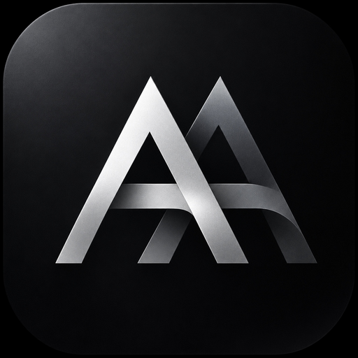

<p align="center">
  
</p>

<h1 align="center">A.stand</h1>

<p align="center">
  <strong>Zero-mutation multi-AI persistent subagent broker for Antigravity.</strong><br/>
  <a href="./README.zh-CN.md">中文说明</a> · <a href="./AGENT_INSTALL.md">🤖 AI Agent Install & Setup Guide (<code>AGENT_INSTALL.md</code>)</a>
</p>

> **🤖 Fastest way to install — let your AI Agent do it for you!**
> Just paste this prompt into **Antigravity**:
> ```text
> Please read AGENT_INSTALL.md in https://github.com/jia-cyber957/A.stand, install A.stand into my Antigravity, and walk me through connecting my preferred AI models.
> ```

A.stand lets your Antigravity Lead Agent stay focused on architecture, planning, and final verification while delegating heavy multi-file implementation (**Hephaestus**) and parallel read-only research/review (**Oracle**) to native external AI harnesses (**OpenAI Codex CLI**, **DeepSeek Harness / OpenAI-compatible APIs & proxies**, **Claude Code**, and **Antigravity CLI**) — with a clean bilingual side-panel console and real upstream Prompt Cache telemetry.

---

## Why A.stand? (7 Core Highlights)

1. **Real Lead-Quota Savings — Never Floods Your Main Chat**
   - Subagents read dozens of files, edit code, and loop through builds/tests inside their own isolated context (even 200K+ tokens).
   - Your Lead Agent receives **only the concise final report** (1–3K chars), keeping your main conversation crisp and dramatically reducing Lead model token usage.

2. **95%–99.8% Real Upstream Prompt Cache + Explicit Session Lifecycle**
   - Every new unrelated task starts a clean fresh session (zero cross-task bleed).
   - Follow-ups on the same task pass the explicit `sessionId` to resume context and Prompt Cache across restarts (real billing counters from Codex, DeepSeek, Anthropic, and `dsh` zstd session logs — never guessed).

3. **Antigravity-Native Collapsible Conversation Timeline**
   - Click any running or finished job in the side panel to view a calm, borderless, Antigravity-style timeline:
     - Collapsible **Message from Lead Agent**
     - **`Thought for 8s ›`** (expandable reasoning block)
     - **`Analyzed gateway.go #L315-455`** / **`Edited gate.go +13 -4`** / **`Searched "pattern"`**
     - **`Ran go test ./... · Exited with code 1 ›`** (expandable scrollable terminal output)
     - Clean **Markdown Final Response** at the bottom, preserving expanded blocks across live 2s refreshes.

4. **Opt-in Async Background Mode ("Chat While It Works") + Zero-Token Doorbell**
   - Disabled by default for predictable synchronous runs; toggle ON in **Settings → Async Background Mode**.
   - When ON, dispatching a subagent unlocks your chat box in ~1 second and attaches a zero-dependency Node doorbell (`wait-job.mjs`, **0 AI tokens**, ~0% CPU).
   - **0 Lead Agent polling turns** while the subagent works for 5–20 minutes — when it finishes, stalls, or errors, the doorbell automatically wakes the Lead Agent with a 3-line summary (and never interrupts if you're chatting about another topic).

5. **Opt-in 2-Choice Stall Gatekeeper AI + Crash Recovery**
   - Optional **Stall Gatekeeper AI** (default OFF): on silence timeout, reads only the task brief + last 30 X-ray lines (never 200K full history) and strictly returns `CONTINUE` (slow build still healthy, don't wake Lead) or `ALERT` (truly stuck, wake Lead) — never edits or steers code.
   - **Accidental-Close Recovery**: job state & `sessionId` persist atomically to disk; if Antigravity closes mid-run, restarting displays an **`⚠ Interrupted`** banner with one-click **Copy Resume Prompt**.

6. **Zero-Mutation Purity & Hard Safety Guardrails**
   - **Never touches** `~/.codex/config.toml`, `~/.dsh/*`, `~/.claude/*`, or `~/.gemini/antigravity-cli/*`.
   - **Master Hard Switch**: OFF = hard-blocked inside MCP server (0 external calls).
   - **Secret Isolation**: API keys live solely in private `secrets.json` (cross-origin endpoint edits require re-entering the key).
   - **Two-Layer Sandbox**: `Oracle` is strictly read-only (parallel slots). `Hephaestus` defaults to `workspace-write` with a per-workspace write mutex. Settings can enable parallel Git worktree writers or allow full access.

7. **Two-Level API Channels, Live Codex Quotas & Automatic Failover**
   - Add an OpenAI-compatible API Channel once (DeepSeek, OpenRouter, self-hosted gateway, etc.) and click **Fetch Models** (`GET /models`) to batch-import models.
   - Live **Codex 5h / 7d quota tracking**, per-role ordered priority queues with cooldown/auto-restore, bilingual Chinese/English UI, and a 9-section automated E2E test suite (including headless strict-CSP browser checks).

---

## Manual Quick Start

### Requirements
- **Node.js `>= 20`** (`>= 24.9.0` if using DeepSeek Harness `dsh` for API-key / proxy models)
- At least one external harness:
  - **OpenAI Codex CLI**: `npm install -g @openai/codex` → `codex login`
  - **DeepSeek Harness (`dsh`)** *(for DeepSeek & OpenAI-compatible APIs/proxies)*: `npm install -g @deepseek-ai/dsh@latest`
  - **Claude Code CLI**: `npm install -g @anthropic-ai/claude-code` → `claude`
  - **Antigravity CLI**: `agy`

### Install into Antigravity
```bash
npm install
npm run install:antigravity
```
Restart Antigravity once, then open **A.stand** from the left sidebar or the right pane **`+`** button.

### Verify & Uninstall
```bash
npm run check:contracts       # Detect local CLIs & verify Codex protocol schema
npm run test:e2e              # Run full 9-section E2E + strict-CSP browser suite
npm run uninstall:antigravity # Clean removal (zero external configs touched)
```

---

## Architecture & Docs

```text
Antigravity Lead Agent (5 concise MCP tools + Skill + Rules)
   └── A.stand Plugin (~/.gemini/config/plugins/agent-relay/)
         ├── Side-Panel Console (Team · Models/Channels · Cache · Settings · 中/EN)
         ├── Core Broker (Hard Switch · Concurrency · Doorbell · Gatekeeper · Crash Recovery)
         └── Isolated Engine Adapters (1 file = 1 engine)
               ├── src/engines/codex.mjs        (native codex app-server)
               ├── src/engines/acp.mjs          (standard ACP -> dsh --profile acp)
               ├── src/engines/claude-code.mjs  (claude stream-json --resume)
               └── src/engines/antigravity.mjs  (agy headless CLI)
```

- [AGENT_INSTALL.md](./AGENT_INSTALL.md) — AI-Agent executable install, engine setup & model pairing guide
- [HANDOVER.md](./HANDOVER.md) — Current implementation state & engineering handover
- [UPGRADING_ENGINES.md](./UPGRADING_ENGINES.md) — Adapting to upstream CLI updates
- [docs/ROADMAP_WORKTREE.md](./docs/ROADMAP_WORKTREE.md) — Opt-in parallel writers via Git worktrees
