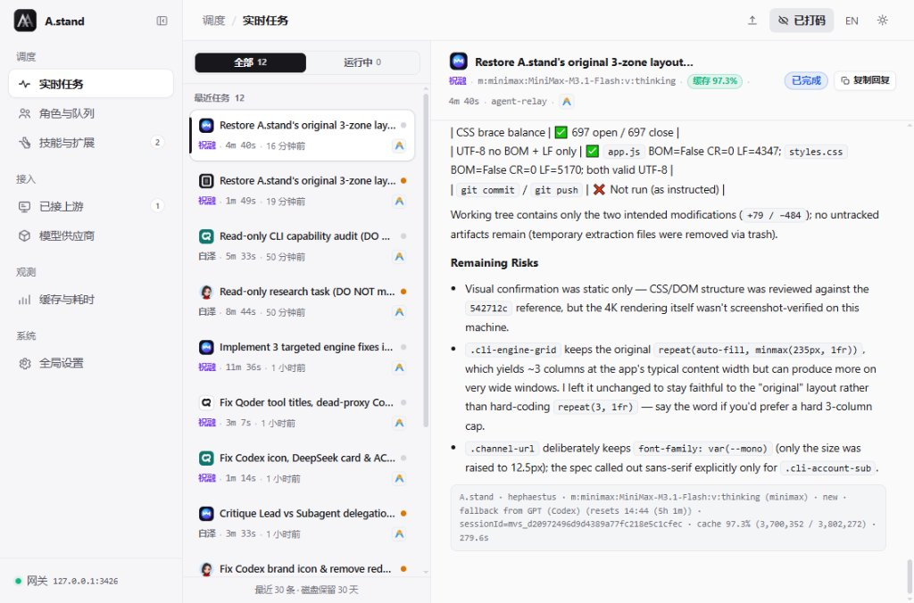
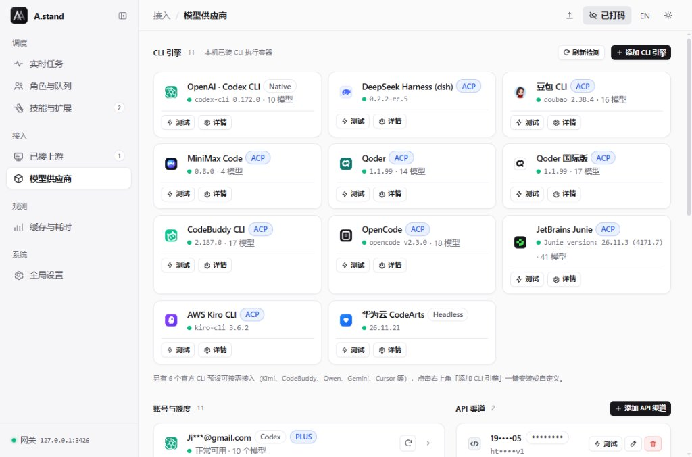
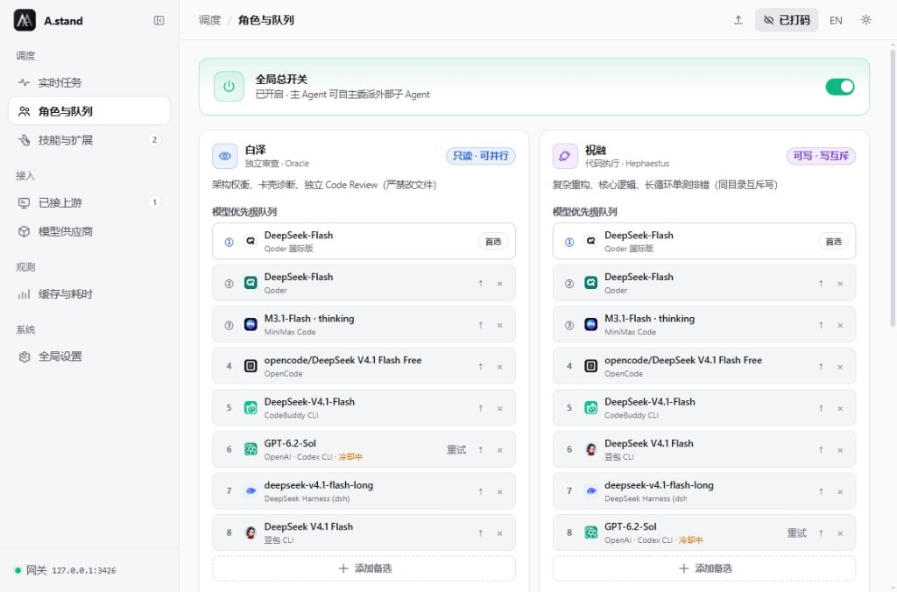
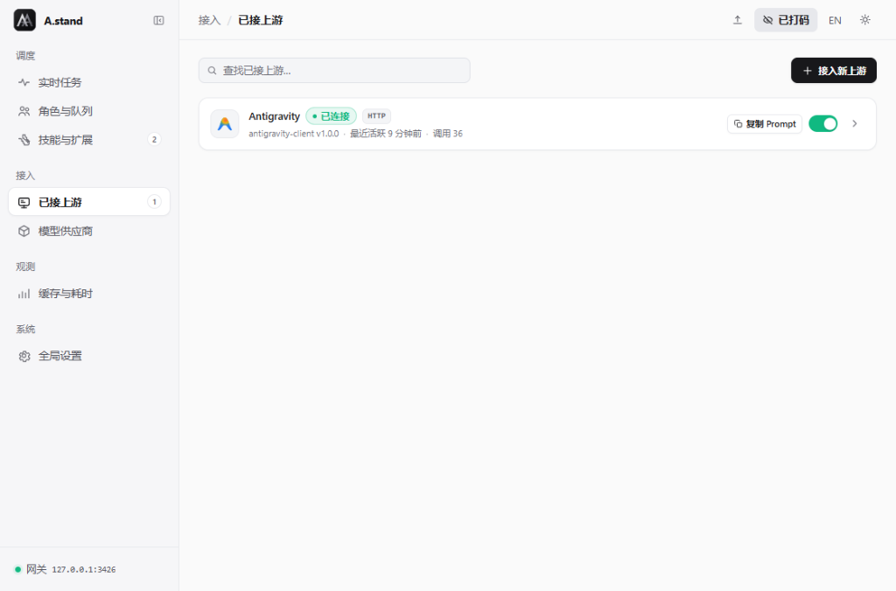

<p align="center">
  
</p>

<h1 align="center">A.stand <sup>v2</sup></h1>

<p align="center">
  <strong>把本机 13+ 官方 AI 编码 CLI，变成任意 MCP 宿主的常驻、隔离子 Agent</strong><br/>
  Windows 托盘常驻桌面控制台 · 本地 Streamable HTTP 守护进程 <code>127.0.0.1:3426</code><br/>
  真实 Prompt Cache · 配额池化与自动轮换 · 零改写外部 CLI 配置
</p>

<p align="center">
  <a href="./README.md">English</a> · <a href="./AGENT_INSTALL.md">AI Agent 安装手册</a> · <a href="./docs/ARCHITECTURE.md">架构文档</a> · <a href="./SECURITY.md">安全策略</a> · <a href="./llms.txt">llms.txt</a>
</p>

<p align="center">
  <a href="https://github.com/jia-cyber957/A.stand/actions/workflows/ci.yml"></a>
  <a href="./LICENSE"></a>
  = 20" />
</p>

> **最省事的安装法：直接让你的 AI 帮你装。**
> 把下面这句话发给你的 **Antigravity / Claude Code / Cursor / Codex** 等任意 MCP 宿主：
> ```text
> 请先阅读 https://github.com/jia-cyber957/A.stand 中的 AGENT_INSTALL.md，帮我安装并启动 A.stand v2，接入我当前的 MCP 客户端，并引导我配置模型供应商与队列。
> ```
> 它会按 [AGENT_INSTALL.md](./AGENT_INSTALL.md) 完成环境探测、构建启动、MCP 接入、规则与 Skill 落位，并在每一步需要你确认时停下来询问。

---

## 它解决什么问题？

A.stand v2 是**一个常驻本机的桌面控制台 + 本地 HTTP 守护进程**（默认只监听 `127.0.0.1:3426`）。它把你机器上已经安装、已经登录的官方 AI 编码 CLI，统一变成可以被**任意 MCP 宿主**调用的持久化子 Agent：

- **主上下文保持干净**：子 Agent 读几十个文件、反复改代码、滚 200K+ token 的工具输出，全部隔离在子 Agent 自己的进程里；Lead Agent 只收到 **1–3K 的精炼总结**，主对话不变脏、不变慢。
- **真缓存，不是估算**：同任务凭 `sessionId` 续接，跨重启仍能命中上下文；实测 **95%–99.8% Prompt Cache**，命中率直接读取上游真实计费字段（Codex / DeepSeek / Anthropic / `dsh` 投影缓存与压缩日志）。
- **配额池化与轮换**：把免费额度、随订阅附带的额度、多个订阅账号放进同一条优先级队列；遇到 429 / 5xx / 401 自动冷却、切换、到点回切，主 Agent 不再被单一额度卡死。
- **零改写外部 CLI 配置**：A.stand 自身不编辑 `~/.codex/config.toml`、`~/.dsh/`、`~/.claude/`、`~/.gemini/antigravity-cli/` 等配置文件；运行期只使用临时启动参数、隔离 profile 与进程级环境变量。

---

## 界面预览（4K ClearType）

### 实时任务：多 CLI 同屏协作，真实缓存与可折叠步骤



聊天室式实时流：每个任务显示来源 CLI、角色（白泽 / 祝融）、耗时与真实缓存命中率；`已分析` / `已编辑` / `运行测试` 等步骤可折叠，底部直接渲染 Markdown 最终回复。右上角 `已打码` 可一键隐藏账号与密钥，方便截图分享。

### 模型供应商：三区布局，CLI / 账号额度 / API 渠道



上方是 CLI 引擎网格（原生 / ACP / Headless），左下是账号与真实额度，右下是 OpenAI 兼容 API 渠道。CLI 安装、升级、登录、模型白名单、额度刷新都在同一个页面完成。

### 角色与队列：白泽只读并行，祝融可写互斥



白泽（Oracle）严格只读、可多路并行；祝融（Hephaestus）默认 workspace-write 且同目录写互斥，可在设置中开启 Git Worktree 并行写。每条队列支持首选、备选、冷却、重试与智能选型。

### 已接上游：一键 AI 接入 Prompt 与 HTTP / stdio MCP



任何 MCP 客户端都能接入：生成专属令牌后复制 **AI 接入 Prompt**，直接发给宿主 AI，它会一次性完成 MCP 配置、委托规则与 Skill 安装；也提供等价的 HTTP JSON 与 stdio 桥命令。

---

## 四步上手

### 第 1 步：安装与启动

**懒人法（让你的 AI 帮你装）**

把上面的安装 Prompt 发给任意宿主 AI，或直接打开 [AGENT_INSTALL.md](./AGENT_INSTALL.md)。这是为 AI Agent 写的可执行手册，包含环境探测、构建、接入、供应商登录与验收清单。

**手动启动（源码）**

```bash
git clone https://github.com/jia-cyber957/A.stand.git
cd A.stand
npm install
npm run build
node dist/daemon.mjs
```

启动后，常驻守护进程只监听本机回环地址，控制台地址为 `http://127.0.0.1:3426`。Tauri 桌面版会自动打开窗口；纯 daemon 模式可在浏览器打开 `http://127.0.0.1:3426/?uiToken=<UI_TOKEN>`，`<UI_TOKEN>` 从 `~/.astand/daemon.json`（Windows 为 `%USERPROFILE%\.astand\daemon.json`）读取。

**桌面便携包（Windows 托盘）**

```bash
npm run package:desktop
# 产物：dist-desktop/A.stand/a-stand.exe
```

打包需要本地 Rust/Cargo 工具链与 WebView2。双击 `a-stand.exe` 后常驻系统托盘：关闭窗口只是隐藏，不会杀掉后台子 Agent；右键托盘选择退出才会停止守护进程。

**环境要求**

- **Node.js >= 20**；如果要通过 DeepSeek Harness（`dsh`）接入 API Key / 中转站模型，需要 **Node.js >= 24.9.0**。
- Windows 10/11 + WebView2（桌面托盘包）。
- 至少一个已安装并已登录的官方 CLI，或一条 OpenAI 兼容 API 渠道。

> 旧的 Antigravity 插件接入方式仍保留为可选项：`npm run install:antigravity`。v2 不再依赖它，任何 MCP 宿主都可以直连本地守护进程。

### 第 2 步：上游怎么接

1. 打开 A.stand → 左侧 **已接上游（Upstream Clients）**。
2. 点击 **+ 接入新上游（Connect upstream）**，可填写上游昵称，留空则首次握手时自动识别。
3. 点击 **生成注册码与接入 Prompt**，再点 **复制 Prompt（Copy prompt）**。
4. 把 Prompt 直接发给你当前的宿主 AI（Antigravity / Claude Code / Cursor / Codex / Windsurf / WorkBuddy / VS Code / 任意 MCP 客户端）。

接入流程不区分宿主类型：上述客户端都使用同一条 AI Setup Prompt。这条 Prompt 会一次性完成三件事：写入 MCP 服务器、落位委托规则 `AGENTS.md`、安装配套 `SKILL.md`。如果宿主不支持本地 HTTP MCP，或在 localhost 上弹出 OAuth 授权，Prompt 里也附带了等价的 stdio 桥命令。

**手动配置：Streamable HTTP**

```json
{
  "mcpServers": {
    "a-stand": {
      "type": "streamableHttp",
      "url": "http://127.0.0.1:3426/mcp",
      "headers": {
        "Authorization": "Bearer <YOUR_TOKEN>",
        "X-Astand-Token": "<YOUR_TOKEN>"
      }
    }
  }
}
```

**手动配置：stdio 桥**

适合不支持本地 HTTP MCP、或旧版客户端：

```bash
node dist/stdio-bridge.mjs --url http://127.0.0.1:3426/mcp --token <YOUR_TOKEN>
```

对应的 MCP 配置：

```json
{
  "mcpServers": {
    "a-stand": {
      "command": "node",
      "args": [
        "dist/stdio-bridge.mjs",
        "--url",
        "http://127.0.0.1:3426/mcp",
        "--token",
        "<YOUR_TOKEN>"
      ]
    }
  }
}
```

> 每个上游都有独立令牌与独立的 MCP 会话归属；A.stand 只会绑定 `127.0.0.1`。写入配置后，多数宿主需要刷新 MCP 或再发一条消息才会加载新工具。
> 需要解绑时，在已接上游卡片上点击 **一键复制 AI 剥离 Prompt（Copy AI disconnect prompt）**，让宿主 AI 干净移除 MCP 条目、规则区块与 Skill，避免残留连接报错。

### 第 3 步：模型供应商怎么弄

A.stand v2 支持 **13+ 官方本地 AI 编码 CLI**：4 个原生引擎 + 13 个官方预设，另支持自定义 ACP / Headless CLI 与任意 OpenAI 兼容 API 渠道。

| CLI / 渠道 | 容器 | 典型登录 / 接入 |
| :--- | :--- | :--- |
| **OpenAI Codex CLI** | Native（`codex app-server`） | `npm install -g @openai/codex` → `codex login` |
| **DeepSeek Harness (`dsh`)** | Native ACP | `npm install -g @deepseek-ai/dsh@latest` → 在 API 渠道填入 Key |
| **Claude Code** | Native（`stream-json`） | `npm install -g @anthropic-ai/claude-code` → `claude` |
| **Antigravity CLI** | Headless（`agy`） | `agy` |
| **OpenCode** | ACP | `opencode auth login` |
| **Qoder**（标准版） | ACP | `qoderclicn login` |
| **Qoder 国际版**（Qoder Global） | ACP | `qodercli login` |
| **MiniMax Code** | ACP | `mcode login` |
| **Kimi Code** | ACP | `kimi login` |
| **JetBrains Junie** | ACP | `junie` |
| **AWS Kiro CLI** | ACP | `kiro-cli login --license free --use-device-flow` |
| **华为云 CodeArts** | Headless | `codearts auth login` |
| **CodeBuddy CLI** | ACP | `codebuddy login` |
| **Qwen Code** | ACP | `qwen` |
| **Gemini CLI** | ACP | `gemini` |
| **Cursor CLI** | ACP | `cursor-agent login` |
| **豆包 CLI**（Doubao CLI） | ACP | `doubao login --qr=png` |
| **自定义 ACP / Headless CLI** | ACP / Headless | 自定义 command + args |
| **OpenAI 兼容 API 渠道** | API Channel | Base URL + API Key → Fetch Models |

**模型供应商三区工作流**

- **上方 CLI 引擎区**：一键检测、安装、更新本机 CLI；安装过程有实时进度与阶段提示。每张卡片可以 `测试` 连通性、打开 `详情`、查看模型数量与协议类型。
- **左下账号与额度区**：在应用内完成 OAuth / 扫码登录；CodeBuddy 与 MiniMax 提供 **标准版（Standard）/ 国际版（Global）** 区域选择。每个账号使用独立 profile 目录（如 `CODEX_HOME`、`DSH_HOME`、`XDG_*`），多账号互不污染；支持 Codex / Qoder / Qoder 国际版 / OpenCode 等隔离账号池，遇 429 / 5xx / 401 自动轮换。
- **右下 API 渠道区**：添加 DeepSeek、OpenRouter、自建 OpenAI 兼容网关等渠道；点 `Fetch Models`（`GET /models`）批量导入模型。API Key 只写入私有 `secrets.json`（`0600`），跨域修改 Base URL 会强制重填 Key，防止把旧 Key 重放到新端点。
- **模型白名单**：在 CLI 详情中勾选启用模型；留空表示全部启用。
- **真实额度**：Codex 提供实时 5 小时 / 7 天配额窗口；没有余额接口的渠道会如实标注暂不可读，**绝不造假额度条**。
- **网络自适应**：`utf8EnvChecked` 会自动剥离已经死掉的本地回环代理（例如关掉 Clash / TUN 后残留的 `127.0.0.1:10808`），保留仍然存活的代理；`proxyFingerprint` 在网络切换后回收空闲子进程，避免旧代理环境把请求全部黑洞。

**角色与队列**

- **白泽（Oracle）**：严格只读、可并行多开。适合架构权衡、卡壳诊断、独立 Code Review、跨文件调研。在 A.stand 工具与日志中保持英文名 `oracle`。
- **祝融（Hephaestus）**：可写工作区，默认同目录写互斥。适合多文件实现、核心重构、单测排错闭环；在设置中开启 Git Worktree 并行写后，可把大任务拆成 2–3 个互不重叠文件的并行 writer（分支 `astand/<jobId>`）。在 A.stand 工具与日志中保持英文名 `hephaestus`。
- **优先级队列**：默认 `ordered`，严格按 ①→②→③ 顺延；切到 `smart` 后，主 Agent 可按任务难度从该角色队列中选择模型，同时保留冷却与备选顺序。
- **失败切换**：429 / 5xx / 401 自动冷却并切到下一条；记录上游 `resetsAt`，到点自动回切主模型。全部耗尽时返回 `[ALL_ENGINES_EXHAUSTED]`，并附一份**零 AI、零网络**的本地 handoff brief（只读本地任务目标、已完成步骤、`git status --short` 与输出尾部），不额外烧 token。

### 第 4 步：Skills 与 MCP 协作机制

A.stand v2 向上游只暴露 4 个 MCP 工具：

| 工具 | 用途 |
| :--- | :--- |
| `agent_relay_ask` | 向 `oracle` 或 `hephaestus` 派单；支持并行 `slot`、`waitSec`、`worktree`、`modelId`、`resumeJobId` |
| `agent_relay_poll` | 等待或检查 `jobId` / `jobIds`；`waitSec: 0` + `detail: "full"` 可非阻塞透视 |
| `agent_relay_review` | 让 Oracle 对未提交改动、分支 diff、commit 或自定义范围做独立审查 |
| `agent_relay_session` | `status` / `recover` / `ack` / `compact` / `fork` / `steer` / `interrupt` / `reset` |

三层协作机制各司其职：

1. **`plugin/rules/AGENTS.md`：常驻委托门禁**
   这是宿主始终加载的规则层。它把 Lead Agent 定义为“数字分身 / 技术负责人”：保护昂贵的主上下文，默认把嘈杂执行与多文件调查交给子 Agent；同时明确 Claude Code + OMO 式分工边界、截图到视觉规格的交接方式、干净 `sessionId` 纪律、禁止把工作转给宿主自带通用子 Agent，以及浏览器只用于重大视觉/交互问题的边界。

2. **`plugin/skills/agent-relay/SKILL.md`：按需作战手册**
   这是宿主按需读取的 Skill 层。它覆盖并行 `oracle` 槽位、`waitSec: 0` 同时起跑 + 一次 `agent_relay_poll(jobIds=[...])` 收集、零 Token 异步门铃 `wait-job.mjs`、Git Worktree 并行写、两击排错升级、崩溃恢复与配额耗尽处理。它不会常驻占用每一轮上下文。

3. **应用内「技能与扩展（Skills & Extensions）」：Turn-1 子 Agent 护栏**
   在 A.stand 控制台里管理的技能 / 子 Agent MCP / 模板库。内置「单文件红线与模块化」「测试防作弊护栏」两条默认护栏，只在**新会话首轮**注入一次，后续轮次字节稳定，不伤 Prompt Cache；清空或关闭即停用。你也可以导入本地 `SKILL.md` / 文件夹，并选择「常驻注入」或「按需读路径」。

> 宿主的业务 Skill 始终留在 Lead Agent 侧，不会被自动塞进子 Agent。只有当某个委托任务确实需要遵守特定 Skill 时，才在 brief 中显式传入其路径或提炼后的相关条款，并说明哪些收尾动作仍由 Lead 负责。

---

## 架构一览

```text
任意 MCP 宿主（Antigravity / Claude Code / Cursor / Codex / Windsurf / WorkBuddy / VS Code / ...）
  │  Streamable HTTP  http://127.0.0.1:3426/mcp   （每个上游独立 Bearer Token）
  │  或 stdio 桥      node dist/stdio-bridge.mjs --url ... --token ...
  ▼
A.stand 常驻守护进程（仅监听 127.0.0.1）
  ├── 桌面控制台（Tauri 2 托盘 + WebView2 / 浏览器）
  ├── 4 个 MCP 工具（ask / poll / review / session）
  ├── 调度核心（总开关 · 并发 · 队列与冷却 · 门铃 · 看门狗 · 崩溃恢复 · Worktree）
  └── 引擎层（Codex / Claude Code / Antigravity 原生适配器 · 通用 ACP / Headless 驱动 · API 渠道）
        └── 官方 CLI 在隔离 profile 中运行（A.stand 不编辑其配置文件）
```

---

## 安全与隐私边界

- **只绑回环**：守护进程只监听 `127.0.0.1`，不暴露局域网或公网；MCP 使用每个上游独立的 Bearer Token，控制台 API 使用独立 UI Token。
- **密钥隔离**：API Key 只存放在私有 `secrets.json`（`0600`）；诊断包自动排除 `secrets.json`、API Key、客户端令牌与 Bearer 凭据；界面内置隐私打码。
- **只读 / 可写分层**：白泽始终只读（Codex 原生只读沙箱、ACP 拒绝写权限 fail-closed、Claude Code 只读工具白名单、`agy` 提示词约束）；祝融默认 `workspace-write` + 同目录写互斥，完全访问与 Worktree 并行均需显式开启。
- **零改写**：A.stand 不修改外部 CLI 配置；登录由官方 CLI 自己完成，A.stand 只通过隔离 profile 与临时启动参数驱动它们。
- **总硬开关**：关闭后，MCP 服务端直接拦截所有新任务派发；已运行任务不受影响，但主 Agent 不会继续派新活。
- 完整说明见 [SECURITY.md](./SECURITY.md)。

---

## 验证与常用命令

```bash
# 守护进程健康检查（无需令牌）
curl -s http://127.0.0.1:3426/api/health

# v2 守护进程 / 多 CLI / 恢复链路 E2E
npm run test:v2

# 旧插件协议契约检查（可选）
npm run check:contracts
```

---

## 文档导航

- [AGENT_INSTALL.md](./AGENT_INSTALL.md) — 写给 AI Agent 的可执行安装、上游接入、供应商登录与验收手册
- [docs/ARCHITECTURE.md](./docs/ARCHITECTURE.md) — 系统架构、请求生命周期、引擎适配器、数据模型与测试命令
- [SECURITY.md](./SECURITY.md) — 零侵入保证、密钥隔离、沙箱边界与私密漏洞报告
- [UPGRADING_ENGINES.md](./UPGRADING_ENGINES.md) — 上游 CLI 升级适配指南
- [llms.txt](./llms.txt) — 面向 AI 爬虫与编程 Agent 的机器可读项目索引

---

## 致谢

- **Oh-My-OpenAgent / Oh-My-OpenCode** — 双角色设计（只读的 **Oracle** 顾问/审查者 + 可写的 **Hephaestus** 工程师）的灵感来源。
- **OpenAI Codex CLI** — `codex app-server` JSON-RPC、结构化事件与任务中途 steer。
- **Anthropic Claude Code** — `stream-json` CLI 协议与会话续接。
- **DeepSeek Harness / Agent Client Protocol（ACP）** — 标准化的、模型无关的 Agent 协议。
- **Google Antigravity 与 Model Context Protocol（MCP）** — 宿主平台、MCP App UI 约定，以及 A.stand 赖以构建的工具协议。
- **Tauri 2** — 轻量 Windows 托盘桌面壳与 WebView2 控制台。

以及每一位提交 Bug 报告、引擎适配反馈或 CLI 实测结果的同学。

---

## 开源协议

本项目基于 [Apache License 2.0](./LICENSE) 开源。Copyright 2026 A.stand Contributors。