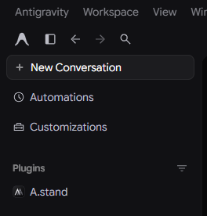
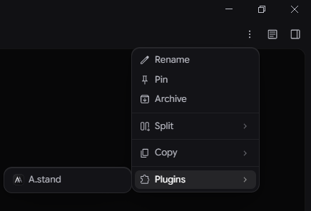
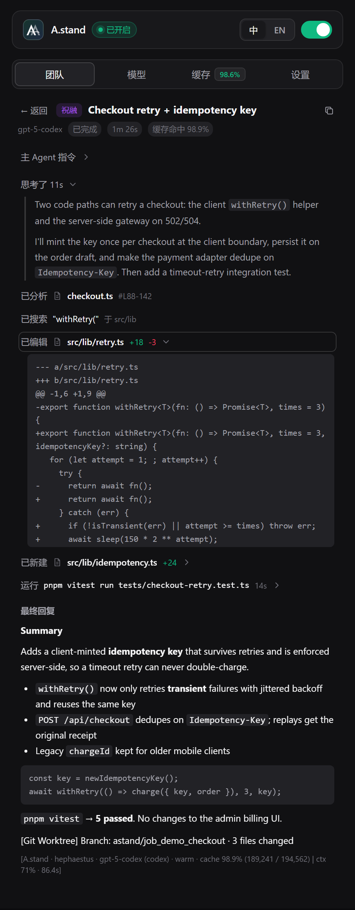
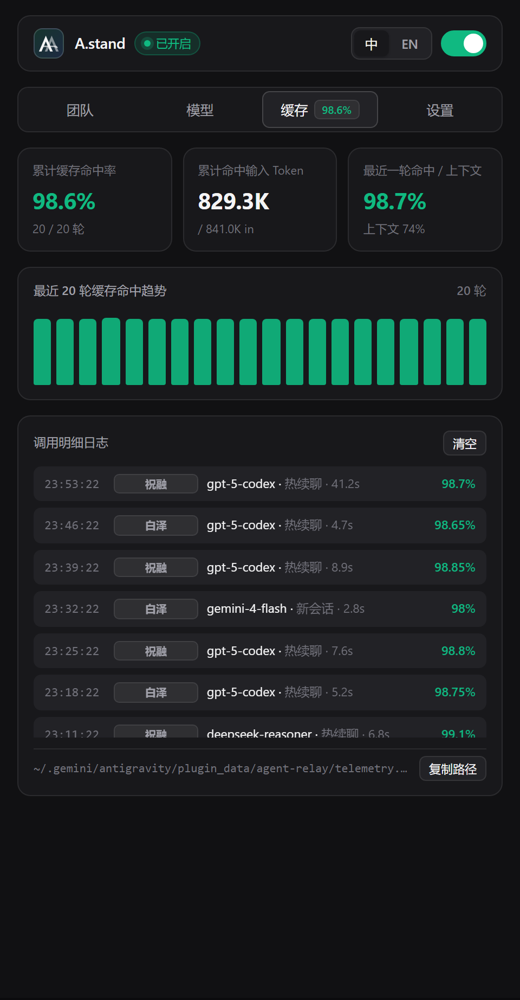

<p align="center">
  
</p>

<h1 align="center">A.stand</h1>

<p align="center">
  <strong>面向 Antigravity 的零侵入、多 AI 持久化子 Agent 插件（替身使者）</strong><br/>
  实时折叠对话流 · 99% 缓存监控 · 后台零轮询门铃 · Git Worktree 并行改代码<br/>
  <a href="./README.md">English</a> · <a href="./AGENT_INSTALL.md">🤖 AI Agent 安装与配置手册 (<code>AGENT_INSTALL.md</code>)</a> · <a href="./docs/ARCHITECTURE.md">架构文档</a> · <a href="./SECURITY.md">安全策略</a>
</p>

<p align="center">
  <a href="https://github.com/jia-cyber957/A.stand/actions/workflows/ci.yml"></a>
  <a href="./LICENSE"></a>
  = 20" />
</p>

> **🤖 最省事安装法：直接让你的 Antigravity 帮你装！**
> 直接把下面这句话发给你的 **Antigravity**：
> ```text
> 请先阅读 https://github.com/jia-cyber957/A.stand 里的 AGENT_INSTALL.md，帮我把 A.stand 安装到 Antigravity，并引导我配置想用的外部模型。
> ```

A.stand 让你的 Antigravity 主 Agent 专注于架构决策、任务拆解与最终验收，把耗时耗额度的重活外包给本机原版外部 AI 引擎（**OpenAI Codex CLI**、**DeepSeek Harness / 任意 OpenAI 兼容 API 与中转站**、**Claude Code**、**Antigravity CLI**）：
- **白泽（Oracle · 独立审查）** —— 严格只读、多路并行：并行深挖代码库、架构权衡、连续排错破局、独立 Code Review；在 A.stand 工具与日志中保持英文名 `Oracle`；
- **祝融（Hephaestus · 代码执行）** —— 工作区可写、默认写互斥：多文件开发、核心重构、单测排错闭环；可在设置中开启 Git Worktree 并行改代码。在 A.stand 工具与日志中保持英文名 `Hephaestus`。

---

## 打开 A.stand 面板

安装完成后重启一次 Antigravity，然后任选一个入口打开面板。

1. **左侧边栏** → 在 **Plugins（插件）** 区域点击 **A.stand**。

   

2. **会话菜单** → 点击会话右上角的 **⋮**，展开 **Plugins（插件）**，再点击 **A.stand**。

   

## 界面预览

### 团队面板 — 子 Agent 实时折叠对话流与 Prompt Cache



### 缓存分析 — 读取上游真实计费的累计命中率



---

## 为什么好用？（7 大核心特点）

1. **真省主模型额度，绝不把 200K+ 过程上下文灌回主对话**
   - 子 Agent 内部读几十个文件、反复改代码编译滚出来的 200K+ 上下文，**全部隔离在子 Agent 自己进程里**；
   - 主 Agent 验收时永远只收最后精炼出的 **1–3K 结果摘要**，大幅省下主模型 Token，同时防止主对话变脏变慢。

2. **实测 95%–99.8% 真实 Prompt Cache 命中率 + 干净的会话隔离**
   - **新任务默认开全新会话**（不同任务绝不串上下文）；
   - **同任务追问凭 `sessionId` 续接**，跨重启依然秒接原上下文与缓存；命中率 100% 读取上游真实计费字段（Codex / DeepSeek / Anthropic / `dsh` 压缩会话日志），绝不估算造假。

3. **Antigravity 原生风格实时折叠对话流**
   - 右侧面板点击任意运行中或历史任务，直接查看清爽无框的对话时间线：
     - 可折叠的 **主 Agent 指令 ›**
     - **`思考了 8s ›`**（点击展开完整推理段落）
     - **`已分析 gateway.go #L315-455`** / **`已编辑 gate.go +13 -4`** / **`已搜索 "pattern"`**
     - **`运行 go test ./... · 退出码 1 ›`**（点击展开完整终端输出）
     - 底部直接渲染干净的 **Markdown 最终回复**，2 秒实时刷新时保持已展开项不乱收起。

4. **可选「后台异步模式（边干边聊）」+ 零 Token 小门铃**
   - 默认关闭（保持传统同步直等）；在 **设置 → 后台异步模式（边干边聊）** 开启后：
   - 派活 **1 秒解锁聊天框**，后台挂零依赖 Node 门铃脚本（`wait-job.mjs`，**0 AI 消耗**），**子 Agent 干活期间主模型 0 次轮询**；
   - 干完、报错或卡死时门铃自动响铃唤醒主 Agent（若你正聊着别的话题，主 Agent 会先答完当前问题再轻声提醒，绝不打断思路）。

5. **可选「二选一卡顿守门员 AI」+ 防误关断点续跑**
   - **卡顿守门员 AI**（默认关闭）：静默超时时只读任务目标 + 最近 30 行透视日志（绝不读 200K 全量），只做二选一判断——`继续等`（慢编译不吵主 Agent）或 `叫醒主 Agent`（真卡死立刻告警），绝不越权改代码。
   - **防误关兜底**：任务状态与 `sessionId` 实时原子落盘；万一中途关掉 Antigravity，重开后团队页顶部自动弹出 **`⚠ 意外中断`** 提醒条，带 **一键复制续跑提示词**。

6. **零侵入纯净性 & 强安全边界**
   - **绝不修改**你本机已有的外部 CLI 配置文件（`~/.codex/config.toml`、`~/.dsh/` 配置、`~/.claude/` 配置、`~/.gemini/antigravity-cli/settings.json`）；
   - 右上角 **总硬开关**（关闭即在 MCP 服务端彻底拦截所有新任务派发）；
   - API Key 独立存放于插件私有 `secrets.json`，改跨域名地址强制重填 Key 防泄密；
   - **按引擎落实隔离**：`白泽（Oracle）` 按引擎能力落实只读边界（Codex 原生只读沙箱、ACP 拒绝写权限 fail-closed、Claude Code 只读工具白名单、`agy` 实验版为提示词约束）；`祝融（Hephaestus）` 默认按工作区互斥写（Codex 原生 `workspace-write`，Git Worktree 并行写与全权限均需在设置里显式开启）；
   - 完整说明见 [SECURITY.md](./SECURITY.md)。

7. **API 渠道两级管理 + Codex 额度追踪 + 全自动 E2E 测试**
   - 添加一次 API 渠道（支持 DeepSeek、OpenRouter 及任意自建 OpenAI 兼容反代网关），点「拉取模型」批量导入；
   - 实时读取 Codex 5 小时 / 7 天配额与重置倒计时，支持按角色配置多 AI 顺延队列与自动回切；中英双语界面，内置 9 组全自动端到端测试（含无头浏览器严格 CSP 校验）。

---

## 引擎支持矩阵

诚实地标注每个引擎当前的成熟度（今天实际可用的能力）：

| 引擎 | 成熟度 | 实际能力 |
| :--- | :--- | :--- |
| **OpenAI Codex CLI**（`codex app-server`） | ✅ **完整原生支持** | 结构化 X-ray 时间线 · 真实 Prompt Cache · 实时 5 小时 / 7 天配额 · 任务中途 steer |
| **DeepSeek Harness**（`dsh` / ACP）—— *DeepSeek、Gemini 4 及任意 OpenAI 兼容 API / 中转站* | ✅ **完整原生支持** | 结构化 X-ray 时间线 · 真实 Prompt Cache · 两级 API 渠道与「拉取模型」 |
| **Anthropic Claude Code CLI**（`claude stream-json`） | 🟦 **标准支持** | `stream-json` 事件 · 会话续接 · Prompt Cache 遥测 |
| **Google Antigravity CLI**（`agy` / Gemini 4） | 🟨 **实验性 / 基础支持** | 无头 CLI 委托 · 基础文本输出（暂不支持 X-ray 时间线与上游缓存计数） |

> 目前只有前两个引擎提供完整的结构化时间线与上游真实缓存计数。Claude Code 与 Antigravity CLI 均可正常使用，但返回的结构信息较少——随着适配器完善，本表会持续更新。

---

## 手动快速安装

### 环境要求
- **Node.js `>= 20`**（若要通过 DeepSeek Harness `dsh` 接入 API Key / 中转站模型，需 **Node.js `>= 24.9.0`**）
- 本机至少安装一个外部引擎（不懂怎么选可以直接问你的 Antigravity，它会参考 [AGENT_INSTALL.md](./AGENT_INSTALL.md) 给你推荐）：
  - **OpenAI Codex CLI**：`npm install -g @openai/codex` → `codex login`
  - **DeepSeek Harness（`dsh`）** *(支持官方 DeepSeek、Gemini 4 及所有 OpenAI 兼容 API/中转站)*：`npm install -g @deepseek-ai/dsh@latest`（必须带 `@latest`）
  - **Claude Code CLI**：`npm install -g @anthropic-ai/claude-code` → `claude`
  - **Antigravity CLI**：`agy`

### 安装到 Antigravity
```bash
npm install
npm run install:antigravity
```
安装后请按[打开面板的图文说明](#打开-astand-面板)操作。

### 自检、测试与卸载
```bash
npm run check:contracts       # 检测本机引擎状态并校验 Codex 协议契约
npm run test:e2e              # 跑全套 9 组 E2E（含严格 CSP 浏览器、门铃、崩溃恢复、跨重启缓存）
npm run uninstall:antigravity # 一键干净卸载（零残留、绝不改外部配置）
```

---

## 文档导航

```text
Antigravity 主 Agent（5 个精简 MCP 工具 + Skill + Rules）
   └── A.stand 插件（<Antigravity 插件目录>/agent-relay/）
         ├── 侧边面板控制台（团队 · 模型/渠道 · 缓存 · 设置 · 中/EN）
         ├── 核心调度器（总硬开关 · 并发 · 门铃 · 守门员 · 崩溃恢复）
         └── 隔离的引擎适配器（1 个文件 = 1 个引擎）
               ├── src/engines/codex.mjs        （原生 codex app-server）
               ├── src/engines/acp.mjs          （标准 ACP -> dsh --profile acp）
               ├── src/engines/claude-code.mjs  （claude stream-json --resume）
               └── src/engines/antigravity.mjs  （agy 无头 CLI）
```

- [docs/ARCHITECTURE.md](./docs/ARCHITECTURE.md) — 系统架构、请求生命周期、引擎适配器、数据模型、沙箱分层、Git Worktree 隔离与测试命令
- [SECURITY.md](./SECURITY.md) — 零侵入保证、API Key 隔离、沙箱边界与私密漏洞报告
- [AGENT_INSTALL.md](./AGENT_INSTALL.md) — 写给 AI Agent 的自动化安装、引擎排坑与模型选型手册
- [UPGRADING_ENGINES.md](./UPGRADING_ENGINES.md) — 上游 CLI 升级适配指南
- [llms.txt](./llms.txt) — 面向 AI 爬虫与编程 Agent 的机器可读项目索引

---

## 致谢

- **Oh-My-OpenAgent / Oh-My-OpenCode** —— 双角色设计（只读的 **Oracle** 顾问/审查者 + 可写的 **Hephaestus** 工程师）的灵感来源。
- **OpenAI Codex CLI** —— `codex app-server` JSON-RPC、结构化事件与任务中途 steer。
- **Anthropic Claude Code** —— `stream-json` CLI 协议与会话续接。
- **DeepSeek Harness / Agent Client Protocol（ACP）** —— 标准化的、模型无关的 Agent 协议。
- **Google Antigravity 与 Model Context Protocol（MCP）** —— 宿主平台、MCP App UI 约定，以及 A.stand 赖以构建的工具协议。

以及每一位提交 Bug 报告或引擎适配反馈的用户。

---

## 开源协议

本项目基于 [Apache License 2.0](./LICENSE) 开源。Copyright 2026 A.stand Contributors。
